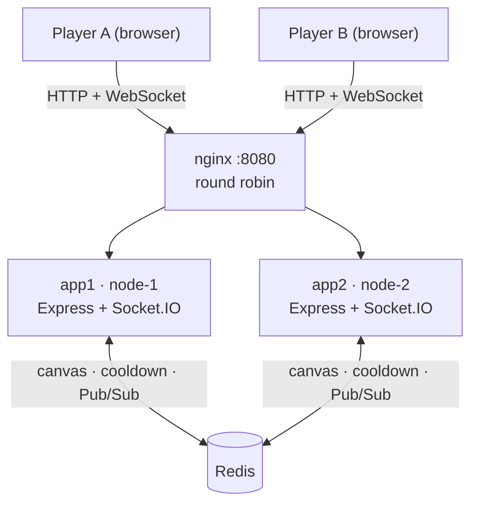

# Scaling a Node.js WebSocket Server with nginx and Redis

A tiny r/place-style pixel game that shows how to run a real-time Node.js server (Express + Socket.IO) on several instances behind an nginx load balancer, by moving every piece of shared state into Redis.

**Tutorial:** [`.agents/skills/scale-websockets-nginx-redis/SKILL.md`](.agents/skills/scale-websockets-nginx-redis/SKILL.md), a general AI skill for scaling any Node.js Socket.IO server behind nginx with Redis, that also reads as a step-by-step tutorial. This repository is its worked example: `02-two-nodes-broken` is the input and `03-redis-fix` the result (see [`references/worked-example.md`](.agents/skills/scale-websockets-nginx-redis/references/worked-example.md)).

## The problem

With one server, everything works. With two servers behind a load balancer, three things break:

| Bug | What you see | Why |
| --- | --- | --- |
| A. Lost notifications | A pixel placed in one window does not appear in the other | `io.emit()` only reaches clients connected to the server that handled the request |
| B. Cooldown bypass | Two quick clicks are both accepted | Each server remembers the last placement in its own memory |
| C. Different canvases | Reloading the page shows other pixels | Each server keeps its own `pixels` object |

All three have one cause: state that lives in the memory of a single process.

## The solution

Make the app servers stateless and keep the shared state in Redis:

- **Canvas**: a Redis hash (`HSET` / `HGETALL`), the same for every server.
- **Cooldown**: one atomic `SET cooldown:<userId> 1 EX 10 NX` per pixel.
- **Real-time broadcasts**: the Socket.IO Redis adapter, which relays every `io.emit()` to all servers through Redis Pub/Sub.



## Run the demo

Requirements: [Docker Desktop](https://www.docker.com/products/docker-desktop/) (with Docker Compose).

```bash
git clone https://github.com/tiago-narciso/ai-skill-scale-websockets-nginx-redis.git
cd ai-skill-scale-websockets-nginx-redis
docker compose up --build
```

Open <http://localhost:8080> in two windows side by side. Each window shows the server it is connected to (`Connected to node-1` or `Connected to node-2`); reload one until they differ, then place pixels.

## Branches

The history is split into three teaching stages:

| Branch | What it shows | Run it with |
| --- | --- | --- |
| `01-single-node` | One Express + Socket.IO server, canvas and cooldown in memory: everything works | `cd server && yarn install && yarn dev`, then <http://localhost:3000> |
| `02-two-nodes-broken` | The same code in two containers behind nginx: bugs A, B and C | `docker compose up --build`, then <http://localhost:8080> |
| `03-redis-fix` | State moved to Redis: the three bugs are gone | `docker compose up --build`, then <http://localhost:8080> |

`main` is `03-redis-fix` plus this documentation. To switch stages, run `docker compose down`, `git switch <branch>`, then `docker compose up --build`. The whole fix in one view:

```bash
git diff 02-two-nodes-broken 03-redis-fix -- server/server.js
```

## API

| Method | Path | Result |
| --- | --- | --- |
| `GET` | `/api/health` | `{ status, node }` |
| `GET` | `/api/pixels` | The whole canvas: `{ size, pixels: { "x,y": "#RRGGBB" }, node }` |
| `GET` | `/api/pixels/:x/:y` | `{ color }` of one pixel (`#FFFFFF` if empty) |
| `POST` | `/api/pixels` | Body `{ x, y, color: "#RRGGBB", userId }`: `201` placed, `400` invalid pixel, `401` missing `userId`, `429` cooldown (with a `Retry-After` header) |

Socket.IO events, from server to client: `hello { node }` on connection, `pixel { x, y, color }` for every placed pixel.

## Configuration

| Variable | Default | Meaning |
| --- | --- | --- |
| `PORT` | `3000` | HTTP port of an app server |
| `NODE_ID` | random UUID | Server name shown to clients (`node-1`, `node-2` in Compose) |
| `REDIS_URL` | `redis://localhost:6379` | Redis connection (`redis://redis:6379` in Compose) |
| `COOLDOWN` | `10` | Seconds between two pixels of the same user |
| `SIZE` | `100` | Canvas width and height, in pixels |

## Project structure

```text
.
├── AGENTS.md                      # tells AI agents when to load the skill
├── .agents/skills/scale-websockets-nginx-redis/
│   ├── SKILL.md                   # the tutorial: a general skill
│   └── references/
│       ├── redis-patterns.md      # one Redis pattern per kind of in-process state
│       └── worked-example.md      # the skill applied to this repository
├── docker-compose.yaml            # nginx + app1 + app2 + redis
├── nginx/nginx.conf               # round-robin load balancer, WebSocket headers
└── server/
    ├── Dockerfile
    ├── package.json
    ├── server.js                  # Express REST API + Socket.IO + Redis
    └── public/index.html          # the canvas client
```

## References

- [Socket.IO: Using multiple nodes](https://socket.io/docs/v4/using-multiple-nodes/)
- [Socket.IO: Redis adapter](https://socket.io/docs/v4/redis-adapter/)
- [Reddit on building and scaling r/place](https://fastly.com/blog/reddit-on-building-scaling-rplace)
- Course: [Service Oriented Architecture, Babeș-Bolyai University](https://www.cs.ubbcluj.ro/~ilazar/soa/)
